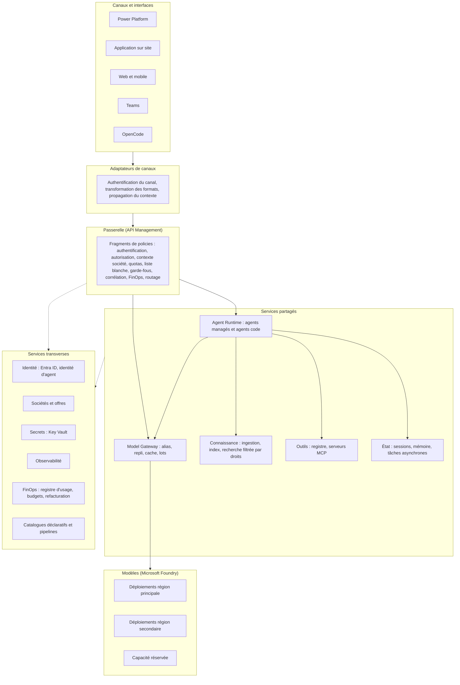

# Architecture cible (V4)

> **Référence, pas liste de tâches.** Ce fichier décrit la plateforme entièrement mature. Ce qui se construit maintenant est dans le fichier de la version en cours.

Cette section décrit la plateforme **entièrement mature**, avec des centaines de cas d'usage. Elle sert de boussole : chaque version de `docs/architecture/` en est un sous-ensemble, jamais une impasse.

## Les quatre couches

| Couche | Responsabilité | Exemples |
|---|---|---|
| **Canaux et interfaces** | Présentation, saisie, expérience utilisateur | Power Platform, application sur site, application web ou mobile, Teams, OpenCode, API métier |
| **Produits IA** | Comportement fonctionnel : instructions, outils et données autorisés | Chatbot, agent documentaire, assistant métier, Software Factory, analyseur de documents |
| **Services partagés de plateforme** | Tout ce qui est commun | Model Gateway, Agent Runtime, identité, sociétés, garde-fous, connaissance, outils, secrets, FinOps, observabilité, catalogues |
| **Infrastructure Azure** | Ressources techniques | Microsoft Foundry, API Management, Key Vault, Application Insights, Log Analytics, Azure AI Search, réseau, stockage |

Un même agent peut être exposé dans Power Platform, dans une application web, dans une application sur site, dans Teams ou par API. Le moteur de l'agent, l'accès au modèle, la sécurité, les quotas, les journaux et le FinOps restent communs. Seul l'adaptateur change.

## Schéma cible

## Inventaire des blocs

| Bloc | Responsabilité | Implémentation de référence | Première version |
|---|---|---|---|
| Identité et accès | Authentifier, résoudre société et utilisateur, contrôler rôles et offres | Microsoft Entra ID, identités managées, Entra Agent ID | V1 |
| Model Gateway | Accès gouverné aux modèles par alias stables | API Management (capacités « AI gateway ») + Microsoft Foundry | V1 |
| Agent Runtime | Exécuter les agents, gérer sessions, erreurs, limites | Foundry Agent Service : agents « prompt » (configuration) et « hosted » (code conteneurisé) | V1 |
| API Management | Point d'entrée unique, policies composées de fragments | Azure API Management | V1 |
| Secrets | Secrets, certificats, credentials d'outils | Azure Key Vault | V1 |
| Observabilité | Métriques, journaux, traces corrélées, alertes | Azure Monitor, Application Insights, Log Analytics, OpenTelemetry | V1 |
| FinOps | Registre d'usage, coûts estimés et réels, budgets, refacturation | Événements d'usage + Azure Cost Management + rapports | V1 |
| Catalogues | Source déclarative des modèles, agents, sociétés, offres… | Fichiers YAML dans Git + Terraform | V1 |
| Garde-fous IA | Filtrage de contenu, protection contre l'injection, données personnelles | Filtres de contenu Foundry, Azure AI Content Safety | V1 |
| Adaptateurs de canaux | Dernière couche entre l'application et la plateforme | Connecteur personnalisé, SDK, backend applicatif | V1 |
| Sociétés | Référentiel, droits, quotas, budgets, isolation | Catalogue + policies + Entra | V2 |
| État et mémoire | Sessions, historique, mémoire longue, tâches | Runtime managé, puis stockage dédié si nécessaire | V1 (sessions) |
| Expérience développeur | Modèles de projets, SDK, bac à sable, portail | Dépôt de modèles, portail développeur | V2 |
| Connaissance (RAG) | Ingestion, indexation, recherche filtrée par droits | Azure AI Search + pipelines d'ingestion | V3 |
| Outils et MCP | Registre d'outils, exposition gouvernée des serveurs MCP | API Management + registre | V3 |
| Résilience et capacité | Mesure des objectifs de service, repli, multi-région, PRA | Backends multiples, disjoncteur, seconde région | V1 (mesure) |
| Conformité | Résidence, RGPD, registre AI Act, audit | Azure Policy, registre des cas d'usage | V1 |
