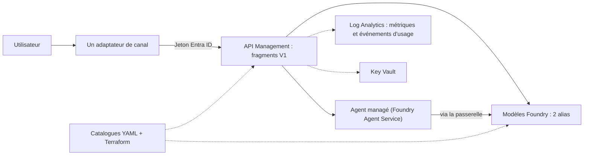

# V1 — Socle minimal

**Objectif.** Mettre 1 à 2 cas d'usage en production avec un accès aux modèles gouverné et un coût mesuré par appel. Prouver la chaîne complète de bout en bout avant d'élargir.

**Déclencheur d'entrée.** Un premier cas d'usage qualifié (classe C1, C2 ou C6), avec un propriétaire métier et un budget.

**Inclus :**

| Domaine | Contenu V1 |
|---|---|
| Environnements | Développement et production. Une région de l'UE : France Central. |
| Identité | Jeton Entra ID obligatoire, un seul tenant. Identité managée entre la passerelle et Foundry. Authentification par clé désactivée sur Foundry. |
| Passerelle | Une instance API Management par environnement. Niveau Consumption (ADR-18). Fragments : authentification, contexte, corrélation, liste blanche, limite d'appels par abonnement, erreurs normalisées, routage par alias. |
| Modèles | 2 alias (un généraliste, un rapide et économique). Déploiements en zone de données UE. |
| Agents | Agents managés définis par configuration. Sessions gérées par le runtime. |
| Canal | Un seul adaptateur, choisi selon le premier cas d'usage. |
| Assistant de développement (C6) | OpenCode branché sur la passerelle. Configuration centrale d'OpenCode (CHN-07). Quotas par application (MGW-03). |
| Garde-fous | Filtres de contenu et détection d'injection directe activés par défaut. |
| FinOps | Événement d'usage par requête avec toutes les dimensions (y compris société). Coût estimé. Un tableau de bord. Budgets Azure par environnement. Plafonds de tokens à la passerelle. |
| Observabilité | Corrélation de bout en bout. Métriques minimales. Alertes de base. Contenu des prompts non journalisé. Plafond quotidien d'ingestion des journaux. |
| Catalogues | Modèles, agents, environnements : fichiers YAML lus par Terraform. |
| DevOps | Dépôt unique. Branche principale protégée. Contrôles automatiques sur chaque demande de changement. Déploiement en production sur approbation. 3 états Terraform. |
| Évaluation | Un jeu de 30 à 50 cas par agent, exécuté avant tout changement de prompt ou de modèle. |
| Conformité | Résidence UE imposée par règle Azure. Registre simple des cas d'usage (`docs/cas-usage/`). L'analyse RGPD n'est pas suivie par la plateforme (CMP-03 abandonnée le 18/11/2026). |

**Explicitement reporté :**

| Sujet | Reporté à | Pourquoi |
|---|---|---|
| Multi-sociétés, refacturation | V2 | Une seule société en V1. Les dimensions sont déjà dans les données (P6). |
| Environnement de recette | V2 | Deux environnements suffisent pour 1 à 2 cas d'usage. |
| Agents « code » | V2 | Les agents managés couvrent C1 et C2. |
| Quotas par utilisateur et par société (MGW-04) | V2 | Les quotas par application couvrent C6 en V1. |
| Limites et métriques de tokens à la passerelle (MGW-20) | V2 | Non disponibles en niveau Consumption. Passage à un niveau payant en V2. |
| Réseau privé (ADR-07) | V2 | Non disponible en niveau Consumption. Niveau payant en V2. |
| Repli multi-backends | V2 | Pas d'engagement de service fort en V1. |
| Exposition progressive, feature flags | V2 | Pas assez d'utilisateurs pour que cela ait un sens. |
| RAG, outils, MCP, mémoire, asynchrone | V3 | À étudier d'abord. Dépendent de l'identité « au nom de l'utilisateur ». |
| Portail libre-service, multi-région, capacité réservée | V4 | Se justifient par le volume. |

**Dimensionnement.** Équipe de 2 à 3 personnes (H1). Les rôles de `docs/gouvernance.md` sont cumulés.

**Coût fixe cible de la V1 : quasi nul, chiffré et suivi** (exigence FIN-07, PO-07). Postes à vérifier : instances API Management (2), ingestion et rétention des journaux, Key Vault, réseau privé (ADR-07), exécution des pipelines. Niveau Consumption en V1, niveau payant à partir de la V2 (ADR-18). Réseau privé en V2 (ADR-07).

**Critères de sortie V1 :**

- [ ] un cas d'usage est en production au niveau N3 ;
- [ ] aucun appel à un modèle ne contourne la passerelle (vérifié par test) ;
- [ ] les limites d'appels par abonnement fonctionnent sur le niveau Consumption (PO-11) ;
- [ ] Foundry refuse les appels hors passerelle, sans réseau privé (PO-13) ;
- [ ] chaque appel produit un événement d'usage attribuable à un utilisateur et à une application, y compris en streaming (PO-12) ;
- [ ] le coût estimé du mois est rapproché de la facture Azure, écart expliqué ;
- [ ] un changement de modèle derrière un alias a été réalisé sans modifier le client ;
- [ ] l'environnement de développement a été reconstruit entièrement depuis le code ;
- [ ] une personne extérieure à l'équipe a déployé un changement en suivant la documentation ;
- [ ] le coût fixe mensuel du socle est connu et suivi.
