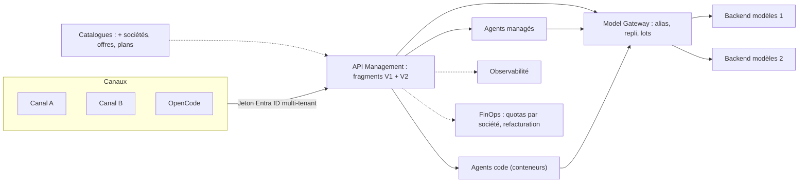

# V2 — Plateforme réutilisable multi-sociétés

**Objectif.** Prouver la réutilisation (un agent, deux canaux), accueillir plusieurs sociétés avec quotas et refacturation, et industrialiser la chaîne de déploiement.

**Déclencheurs d'entrée** (les critères de sortie V1 sont atteints, et au moins un de ces signaux) :

- un deuxième canal est demandé pour un agent existant ;
- une deuxième société doit être embarquée ;
- un troisième cas d'usage est qualifié ;
- un cas d'usage demande une orchestration que la configuration ne permet pas ;
- la dépense en tokens justifie une refacturation.

**Ajouts par rapport à V1 :**

| Domaine | Ajout V2 |
|---|---|
| Environnements | Recette. Réseau privé généralisé. 6 états Terraform. |
| Identité | Plusieurs tenants Entra (ADR-04). Contexte société résolu depuis le jeton. Révocation. |
| Sociétés | Référentiel, onboarding et offboarding déclaratifs, isolation « mutualisée », protection contre le voisin bruyant. |
| Passerelle | Niveau payant d'API Management (ADR-02) : limites et métriques de tokens par application (MGW-20), réseau privé (ADR-07). Fragments : autorisation par offre, contexte société, quotas par société et par utilisateur, validation du corps, suppression des données sensibles. Révisions d'API. |
| Modèles | Plusieurs backends avec disjoncteur. Modèle de repli par alias. Traitement par lots. Procédure de changement de modèle derrière un alias. Suivi des dates de retrait. |
| Agents | Voie « code » sur le même contrat. Cycle de vie en 5 états. Limites par session. |
| Canaux | Deuxième canal sur un agent existant. Modèle d'adaptateur et SDK. Software Factory (C6). |
| FinOps | Refacturation par société, offre, projet. Réconciliation mensuelle. Seuils 50/70/80/90/100 %. Fiche FinOps par composant. Détection des gaspillages par requêtes planifiées. Revues périodiques. |
| Observabilité | Tableaux de bord par offre, société, agent. Politique de journalisation du contenu par offre (ADR-10). Procédures d'investigation. |
| DevOps et GenAIOps | Promotion du même artefact sur trois environnements. Portes d'évaluation bloquantes. Feature flags. Détection de dérive planifiée. Matrice d'approbation. Journal des décisions d'architecture. |
| Expérience développeur | Modèle d'agent, bac à sable plafonné, règles Azure empêchant les contournements. |
| Catalogues | Sociétés, offres, plans de service. Documentation générée. |

**Explicitement reporté :** RAG, outils, MCP, mémoire longue, asynchrone (V3) ; isolation « dédiée », multi-région, capacité réservée, cache sémantique, portail libre-service (V4).

**Critères de sortie V2 :**

- [ ] un même agent est consommé par deux canaux, sans modification de l'agent ni de la plateforme ;
- [ ] une société a été embarquée par une seule demande de changement sur le catalogue ;
- [ ] un test automatisé prouve qu'une société ne peut ni voir ni consommer les ressources d'une autre ;
- [ ] les quotas par société et par utilisateur bloquent en temps réel ;
- [ ] le rapport mensuel par société est produit automatiquement et rapproché de la facture ;
- [ ] aucune mise en production d'agent sans porte d'évaluation franchie ;
- [ ] un retour arrière a été exécuté en recette pour chaque type de composant ;
- [ ] la dérive entre le code et l'existant est détectée automatiquement ;
- [ ] le délai de mise en service d'un cas d'usage standard est mesuré.
