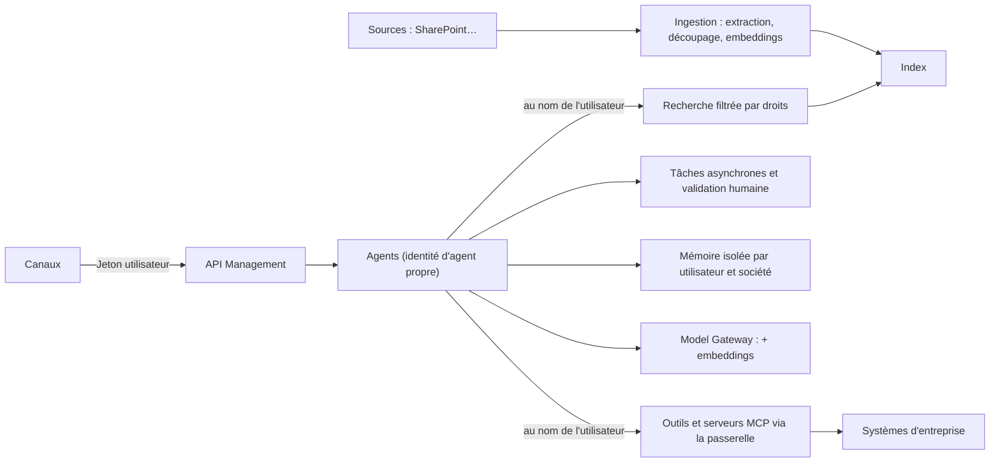

# V3 — Connaissance et outils (RAG, MCP)

**Objectif.** Ouvrir les agents documentaires et les agents qui agissent, sans jamais donner à un agent plus de droits qu'à son utilisateur.

**Déclencheurs d'entrée :**

- les critères de sortie V2 sont atteints (en particulier identité multi-tenant et quotas par société) ;
- un cas d'usage priorisé exige des données privées d'entreprise ou une action dans un système ;
- les études RAG et MCP sont conclues et les décisions ADR-09 et ADR-14 sont prises.

**Travaux préparatoires autorisés en V1 et V2.** Études en bac à sable (niveau N1) : choix de la stratégie d'indexation, test de la reprise des droits SharePoint, évaluation de serveurs MCP. Ces études alimentent les ADR. Elles ne sont ouvertes à aucun utilisateur réel.

**Ajouts par rapport à V2 :**

| Domaine | Ajout V3 |
|---|---|
| Identité | Accès « au nom de l'utilisateur » aux données et outils. Identité propre à chaque agent. |
| Connaissance | Catalogue des sources. Pipeline d'ingestion standard. Recherche filtrée par les droits de la source. Propagation des suppressions. Citations obligatoires. Premier connecteur : SharePoint. |
| Outils | Registre des outils. Serveurs MCP exposés uniquement par la passerelle. Classement lecture / écriture / irréversible. Validation humaine pour les deux derniers. |
| Agents | Listes blanches d'outils et de sources. Mémoire longue. Exécution asynchrone. |
| Garde-fous | Protection contre l'injection indirecte (par les documents et les résultats d'outils). Tests adverses renforcés. Red teaming avant N3. |
| Sociétés | Isolation des index et de la mémoire par société (ADR-09). |
| FinOps | Coûts d'indexation, de stockage et d'embeddings par source et par société. Coût par tâche réussie généralisé. |
| Observabilité | Trace jusqu'à l'appel d'outil. Évaluation sur échantillon de traces de production. |
| GenAIOps | Évaluations propres au RAG (pertinence de la recherche, ancrage des réponses) et aux outils (bon outil, bons paramètres). |
| Catalogues | Sources de données, outils. 8 états Terraform. |
| Conformité | Analyse d'impact pour les cas d'usage à données sensibles. |

**Critères de sortie V3 :**

- [ ] un agent documentaire est en production (N3) ;
- [ ] un test automatisé prouve qu'un utilisateur n'obtient jamais un document auquel il n'a pas accès dans la source ;
- [ ] un document supprimé dans la source disparaît des réponses dans le délai défini ;
- [ ] un agent avec outils est en production, et aucune action d'écriture ne s'exécute sans validation humaine ;
- [ ] aucun serveur MCP n'est joignable hors de la passerelle ;
- [ ] le jeu d'évaluation de chaque agent C3 ou C4 contient des attaques par injection indirecte, toutes bloquées ;
- [ ] le coût d'un index est attribué à une source et à une société.
